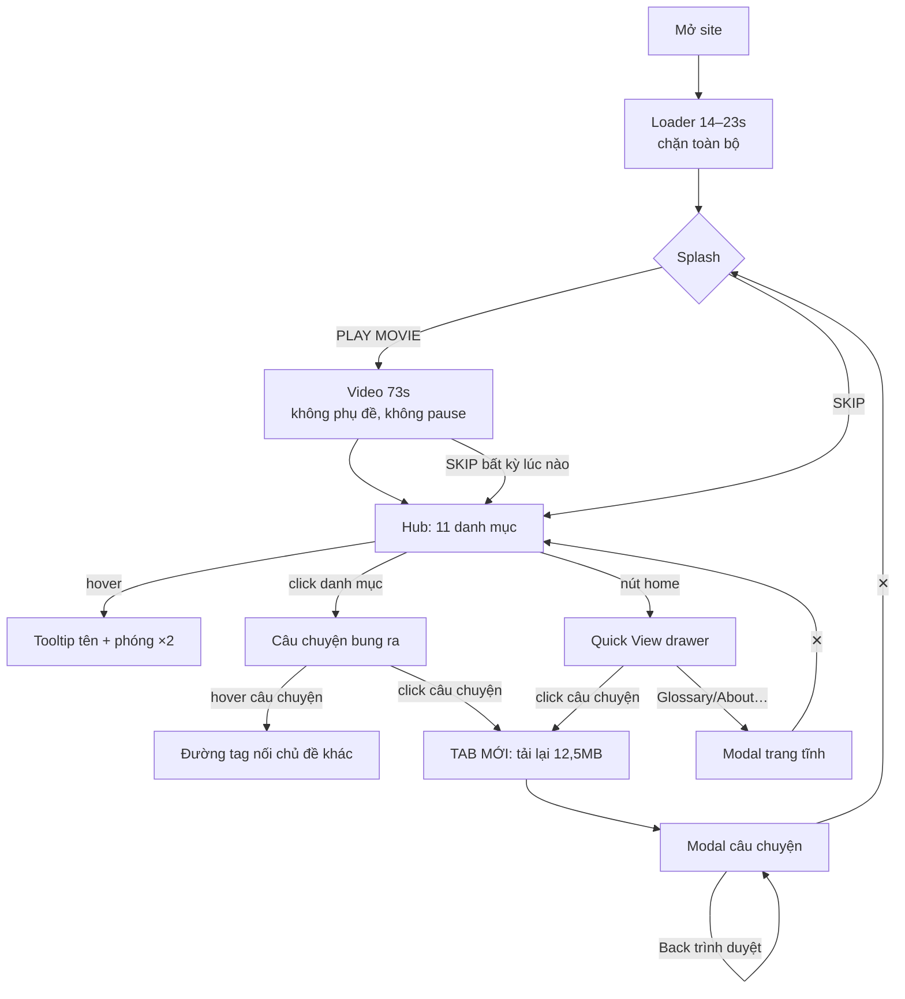
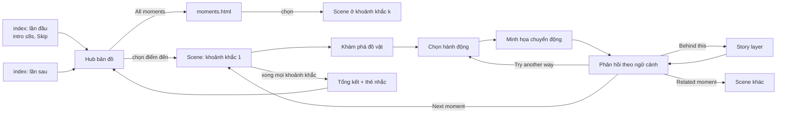
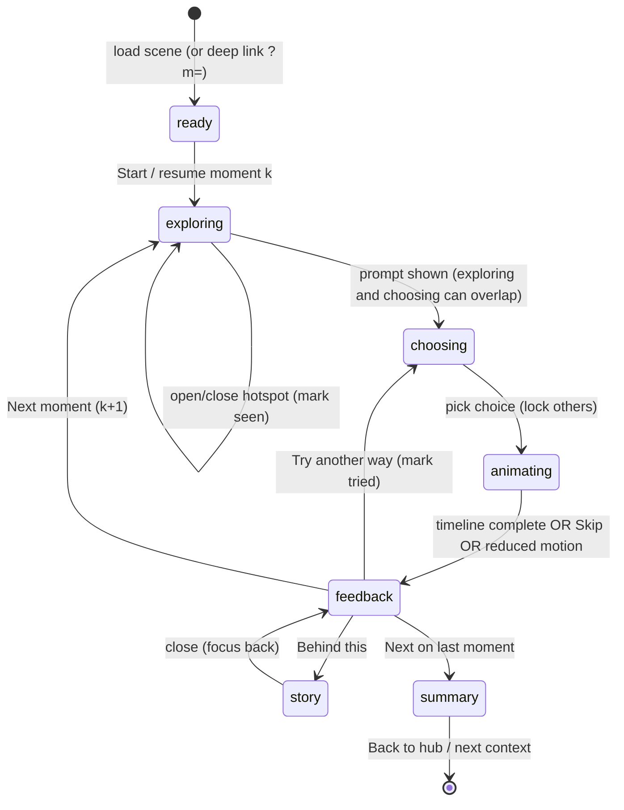

# Nghiên cứu Sandooka → Đặc tả thiết kế CultureCompass

*Ngày khảo sát: 23/10/2026 · Đối tượng: https://sandookamuseum.org/ (bản `style.css?v=1.0.7`) · Người thực hiện: Claude (trình duyệt tích hợp trong Claude desktop)*

Quy ước nhãn trong toàn bộ tài liệu:

- **[Đo]** quan sát hoặc đo được trong trình duyệt, DOM, computed style, network hay mã nguồn công khai.
- **[Suy luận]** suy ra từ bằng chứng nhưng chưa kiểm chứng trực tiếp, hoặc là ước lượng.
- **[Đề xuất]** đề xuất mới cho CultureCompass.

Screenshot nằm trong [`screens/`](screens/) và được dẫn chiếu bằng tên file, ví dụ `08-hub-691.jpg`.

---

## 1. Tóm tắt phát hiện chính

1. **Sandooka là một "bản đồ tri thức" chứ không phải website cuộn.** Màn hình chính là một đồ thị lực D3 (force-directed graph): 1 tâm, 11 danh mục và 63 câu chuyện, có kéo, zoom và hover. Không có trang chủ dạng nội dung. [Đo] `chart.js`, `08-hub-691.jpg`
2. **Bản sắc đến từ chất liệu thật của vùng đất**, không đến từ minh họa: 6 ảnh flycam rừng/ruộng Kodagu crossfade làm nền, đặt dưới các huy hiệu tròn đen với icon line-art trắng. Hình ảnh là "nơi chốn", icon là "đồ vật trong rương" (*sandooka* = cái rương). [Đo + Suy luận]
3. **Ý tưởng mạnh nhất là liên kết chéo bằng tag.** Hover một câu chuyện sẽ hiện đường nét đứt nối tới các câu chuyện cùng tag ở danh mục khác. Trong bài, thuật ngữ gạch chân mở danh sách câu chuyện liên quan. Văn hóa được trình bày như một mạng lưới, không phải danh sách. [Đo] `11-story-hover-tag-lines.jpg`, `15-term-tooltip.jpg`
4. **Video intro 73 giây vừa giới thiệu bối cảnh vừa hướng dẫn cách dùng**, với chữ khắc thẳng vào video. Video không có phụ đề, không nút tạm dừng hay tắt tiếng, nhưng có SKIP rõ ràng. [Đo] `03`–`07`
5. **Chi phí truy cập rất cao.** UI bị chặn tới khi tải xong ~17,9 MB (video 12,56 MB + 6 ảnh nền ~5 MB). Intro sẵn sàng sau ~14–23 giây và không ghi nhớ lượt truy cập trước. Mở một câu chuyện từ bản đồ sẽ mở tab mới và tải lại toàn bộ. [Đo] `12-story-deeplink-reload.jpg`
6. **Nội dung đọc sâu nằm trong modal iframe** dạng "trang giấy" (`#f5f2ef`), Poppins 14px/1.8, căn đều hai bên, cột 600px, ảnh có caption nền tối, carousel và Vimeo. Previous/Next xoay vòng trong cùng danh mục. [Đo] `13-story-modal.jpg`
7. **Truy cập nhanh tồn tại nhưng bị giấu** sau một nút "home" không có nhãn ở mép phải. Drawer "Quick View" là accordion `<details>` gồm 11 danh mục và các trang tĩnh. Không có tìm kiếm. [Đo] `18-quickview-drawer.jpg`
8. **Glossary thừa nhận khác biệt theo vùng** (ba tiểu vùng Surlabi/Mendale/Kiggat naad, "practiced differently"), nhưng là một trang dài 21.574px, không có mục lục hay ô tìm. Đây là tinh thần CultureCompass nên giữ, với hình thức truy cập tốt hơn. [Đo] `20-glossary.jpg`
9. **Accessibility và mobile yếu.** Node SVG không nhận focus. Escape không đóng gì. Mobile không có nhãn chữ và chạm không hiện tooltip. Node câu chuyện chỉ 30px và có thể bị đẩy ra ngoài màn hình. Không có `prefers-reduced-motion`. [Đo] `24`, `25`, `22`
10. **Bài học cho CultureCompass:** giữ "khám phá trong mạng lưới có liên kết + chất liệu nơi chốn + chuyển cảnh nhẹ", bỏ "chờ tải dài, intro bắt buộc, điều hướng không nhãn, bản đồ chỉ dùng được bằng chuột".

---

## 2. Phạm vi khảo sát và giới hạn

### 2.1 Những gì đã làm [Đo]

| Hạng mục | Chi tiết |
|---|---|
| Trình duyệt | Chromium trong Claude desktop (built-in browser), dpr 2 |
| Viewport | **1024×768** (lần tải đầu), **691×785** (kích thước gốc của pane, dùng cho phần lớn screenshot desktop/tablet hẹp), **1440×900** (giả lập, chỉ dùng số đo DOM vì ảnh chụp bị thu nhỏ vào góc, xem `26`), **375×812** mobile (giả lập Android Pixel 8 UA, touch) |
| Lượt truy cập | Lần đầu, tải lại 3 lần (= lần quay lại), deep link `/cuisine-culinary-magic`, mở trực tiếp `template.html` |
| Trạng thái đã thao tác | Loader → splash → Play Movie (tua 0/8/16/35/55/69 s) → kết thúc video → hub → hover danh mục → click danh mục → hover câu chuyện → click câu chuyện → modal → hover/click Next → Back của trình duyệt → Escape → ✕ → drawer Quick View → mở accordion → Glossary → footer drawer → Tab bàn phím → thuật ngữ trong bài → carousel → cuối bài |
| Mã nguồn đã đọc | `index.html`, `script.js`, `chart.js`, `style.css`, `responsive.css`, `variables.css`, `loader.css`, inline script và style của `template.html` |
| Network | Performance Resource Timing (kích thước, thời điểm bắt đầu/kết thúc), console |

### 2.2 Giới hạn

- **Tablet 768×1024 chưa chụp riêng.** Giả lập lớn hơn pane cho ảnh lỗi. Ở 691px, CSS rơi vào breakpoint `576–767.98` và JS dùng `initialScale 1.3`. Breakpoint `768–991` (scale 2) chỉ được suy ra từ code. [Suy luận]
- **Desktop 1440×900** chỉ có số đo DOM: cụm node rộng khoảng 370px giữa khung 1440px, node 100px. Không có ảnh rõ.
- **Lần tải đầu khi pane bị ẩn** cho SVG kích thước 0×0 nên đồ thị nằm ngoài màn hình (`26-env-bug-graph-missing-1024.jpg`). Tải lại khi pane hiển thị thì bình thường, nên đây được coi là lỗi môi trường, không phải lỗi của site. Tuy vậy, nó cho thấy kích thước đồ thị bị chốt một lần lúc script chạy (`var width = window.innerWidth`). [Đo + Suy luận]
- **Âm thanh:** video phát có tiếng (`muted:false, volume:1`), nhưng công cụ không nghe được nên **không đánh giá nội dung âm thanh**. Site không có nút bật/tắt âm.
- **Chuyển động:** không quay video. Thời lượng và easing lấy **từ CSS/JS**, kèm chuỗi screenshot theo mốc thời gian. Cảm nhận "mượt" không được đánh giá.
- **Chưa test:** iOS/Safari thật, screen reader, mạng chậm có kiểm soát (throttling), Lighthouse/Core Web Vitals (không có số liệu, không bịa), nội dung chi tiết của About/Resources/Terms/Acknowledgements (đã biết chúng dùng chung template modal), form "Submit your story" và trang Contact (nằm ở domain admin, không mở).
- Tooltip của danh mục trên mobile: chỉ test một lần chạm vào node Cuisine.

Vì những giới hạn trên, báo cáo này **không phải khảo sát toàn diện**.

---

## 3. Phân tích Sandooka

### A. Ý tưởng và hướng nghệ thuật

**Ấn tượng đầu tiên.** Màn hình xám với spinner 8 chấm kéo dài 14–23 giây (`01`). Sau đó là cảnh rừng nhìn ngang, logo chữ mảnh in hoa giãn chữ (logo dạng ảnh) và hai nút viền trắng mỏng PLAY MOVIE / SKIP (`02`). Cảm giác là lặng, rộng, "đứng trên đồi nhìn xuống vùng đất". [Đo + Suy luận]

**Câu chuyện thiết kế.** *Sandooka* nghĩa là "rương báu". Video kể: "Sandooka is a trunk of treasures with stories…", rồi "We welcome you to explore this treasure trove of stories in histories, in rituals, in old trunks, in homes, in hearts…" (`04`, `05`). Khi vào hub, rương được "mở ra" thành một chòm huy hiệu (`08`). Ẩn dụ "rương → đồ vật → câu chuyện" quyết định toàn bộ IA. [Đo nội dung video, Suy luận về ý đồ]

**Yếu tố tạo bản sắc**

| Yếu tố | Bằng chứng | Giúp hiểu nội dung hay chủ yếu tạo hiệu ứng? |
|---|---|---|
| Flycam rừng, ruộng, đường đèo Kodagu làm nền liên tục | `.background>img` × 6, crossfade 10s; `08`, `10` | Tạo cảm giác nơi chốn, **không mang thông tin** |
| Huy hiệu tròn đen + icon line-art trắng cho mỗi danh mục (nồi, nhà, trang sức, bản đồ…) | ảnh `*_Circle.png` từ S3; `09` | Giúp nhận diện danh mục **khi đã có nhãn**. Không có nhãn thì khó đoán (mobile) |
| Ảnh thumbnail thật cho câu chuyện | `story.thumbnail`; `10` | Cho biết nội dung, nhưng chỉ 30–39px |
| Đường cong Bézier trắng tâm → danh mục → câu chuyện | `path.link`, `stroke 1px #fff` | Thể hiện cấu trúc cha–con |
| Đường nét đứt nối câu chuyện cùng tag | `path.tag`, `stroke-dasharray:4`, `opacity:.5`; `11` | **Giúp hiểu**: văn hóa liên thông giữa các chủ đề |
| "Trang giấy" `#f5f2ef` cho phần đọc | `--ct-bg-color-1`; `13` | Chuyển chế độ từ "khám phá" sang "đọc" |
| Serif EB Garamond in hoa trong danh sách liên quan | inline CSS `template.html`; `15` | Chủ yếu là cảm giác "di sản/lưu trữ" |

**Nguyên tắc thiết kế cốt lõi**

1. **Một ẩn dụ chi phối mọi thứ.** Rương báu quyết định intro, hub và cách gọi tên ("Quick View", "treasure trove"). Bằng chứng: `04`, `05`, `07`.
2. **Nơi chốn là nền, tri thức là tiền cảnh.** Ảnh flycam luôn ở `z-index:-1`, mọi thông tin nằm trên lớp đen/trắng tương phản cao. Bằng chứng: `style.css .background`, `08`.
3. **Khám phá phi tuyến bằng mạng lưới.** Không có thứ tự bắt buộc. Người dùng chọn danh mục rồi chọn câu chuyện, tag dẫn sang chủ đề khác. Bằng chứng: `chart.js click()`, `tagConnectors`.
4. **Hai nhịp: lướt bằng hình, đọc bằng chữ.** Hub gần như không có chữ, modal là văn bản dài. Bằng chứng: `08` so với `13`.
5. **Tiết lộ dần.** Lúc đầu chỉ có 11 danh mục (`collapseAll()` sau 500ms). Câu chuyện chỉ hiện khi click, và mỗi lần chỉ mở một nhánh (`currentlyOpenStory`).
6. **Bảng màu đơn sắc cho UI**: đen, trắng, xám giấy. Màu sắc hoàn toàn đến từ ảnh. Bằng chứng: `variables.css` chỉ có 1 màu; mọi node `#000/#fff`.
7. **Tôn trọng nguồn và người đóng góp.** Mỗi ảnh có caption "Photo courtesy of…". Cuối bài có "Text:", "Primary resources:" và "(Please check the glossary for the meaning of vernacular terms.)". Bằng chứng: `16-story-end.jpg`.
8. **Thừa nhận biến thể văn hóa.** Glossary nói rõ có ba tiểu vùng và thực hành khác nhau, và tham chiếu "Pattole Palame" như chuẩn "as far as possible". Bằng chứng: văn bản Glossary.

### B. Kiến trúc thông tin và luồng người dùng

**Sitemap thực tế** [Đo]

```
sandookamuseum.org  (1 file index.html, mọi thứ khác là trạng thái)
├─ [trạng thái] Loader (chặn tới khi tải xong)
├─ [trạng thái] Splash: PLAY MOVIE / SKIP
│   └─ [trạng thái] Video intro 73s (SKIP thu lên đỉnh màn hình)
├─ [trạng thái] Hub bản đồ (D3)
│   ├─ 11 danh mục (node depth1) → mở nhánh câu chuyện (depth2)
│   └─ câu chuyện → window.open('/?id=…&category=…', '_blank')  ← TAB MỚI
├─ [URL riêng, pushState] /{category-slug}-{story-slug}   ví dụ /cuisine-culinary-magic
│   └─ Modal: tiêu đề · ✕ · Previous/Next (vòng trong danh mục) · iframe template.html?slug=…
├─ [URL riêng, pushState] /{page-slug}: About, Terms of Use, Resources,
│   /glossary-of-commonly-used-kodava-terms, Acknowledgements  (modal, ẩn Prev/Next)
├─ [trạng thái] Drawer phải "QUICK VIEW" (nút home): 11 <details> + 63 câu chuyện + link trang tĩnh
├─ [trạng thái] Footer drawer (nút ^ ở đáy): nhà tài trợ, trustees, liên hệ, mạng xã hội
└─ [ngoài site] admin.sandookamuseum.org/contact/, /storyform/  (tab mới, không mở trong khảo sát)
```

Bên trong `template.html`, thuật ngữ gạch chân mở popover danh sách câu chuyện cùng tag (`./template.html?id=…`). Link này điều hướng **bên trong iframe**. [Đo HTML; điều hướng trong iframe là Suy luận, chưa click]

**User flow chính** [Đo]



**Điểm bắt đầu và lựa chọn đầu tiên.** Lựa chọn đầu tiên là "xem phim hay bỏ qua". Lựa chọn nội dung đầu tiên là chọn 1 trong 11 icon không nhãn (nhãn chỉ hiện khi hover trên desktop).

**Nhận biết vị trí.** Trong modal có tiêu đề câu chuyện và tên danh mục viết thường (`13`). URL đẹp phản ánh vị trí. Trên hub, nhánh đang mở là chỉ báo duy nhất. Không có trạng thái "đã xem", không có breadcrumb về hub.

**Cân bằng tự do và hướng dẫn.** Hướng dẫn nằm hoàn toàn trong video (`06`: "Navigate using TAGS", `07`: mô phỏng hub và con trỏ). Ai bấm SKIP sẽ không nhận được hướng dẫn nào khác. [Đo]

**Tìm nhanh.** Quick View cho phép đến bất kỳ câu chuyện nào trong 3 thao tác (home → danh mục → tiêu đề), nhưng nút home không có nhãn và không có tìm kiếm.

**Điểm gây lạc hướng và thao tác thừa** [Đo]

- Click câu chuyện mở **tab mới** và bắt chờ tải lại (`12-story-deeplink-reload.jpg`: loader vẫn còn ở giây 40 trong lần đo).
- Đóng câu chuyện mở từ deep link đưa người dùng về **splash** chứ không về hub (`17`), nên phải bấm SKIP lại.
- Nút home đè lên mép nút ✕ ở 691px (`13`).
- Escape không đóng modal, cũng không đóng popover thuật ngữ.
- Popover thuật ngữ chỉ liệt kê câu chuyện, không giải nghĩa. Muốn biết nghĩa phải mở Glossary dài 21.574px.
- Câu chuyện có ít hơn 2 câu chuyện anh em thì ẩn Prev/Next (`hasNav = next && prev`). Danh mục "Point of View" chỉ có 1 câu chuyện.

### C. Bố cục từng kiểu màn hình

#### C1. Loader (`01`)
- Mục đích: chờ tải. Nền `radial-gradient(circle at 50%, #666, #000)`, spinner 8 chấm `font-size 25px, scale(.5)`, đặt ở `top: calc(50vh - 5rem)`. [Đo]
- Thành phần fixed: tab home ở mép phải đã hiện **trước** khi nội dung sẵn sàng. [Đo]

#### C2. Splash (`02`, `23`)
- Thứ tự: logo (cao 5.75rem, margin-bottom 4rem) → hai nút (rộng 7rem, viền 1px trắng, padding .5rem, cách nhau 4rem). Cụm `#skip` đặt `fixed` ở `top: calc(50vh − 4rem)`, căn giữa ngang. [Đo]
- Nền: frame đầu của video (`first-frame.png`, `background-size: cover`). Nút hover `rgba(255,255,255,.5)`, active `.75`. [Đo]
- Mobile: cùng bố cục. Ảnh `first-frame.png` là ảnh ngang nên tạo vệt nối giữa poster và video dọc (`23`). [Đo hình; nguyên nhân là Suy luận]

#### C3. Video intro (`03`–`07`)
- Toàn màn hình `object-fit: cover`. Chữ trắng sans lớn ở giữa, từ khóa danh mục nằm rải rác. SKIP thu nhỏ lên đỉnh giữa (`#skip.top`). [Đo]
- Nhịp nội dung: địa lý (bản đồ Kodagu với các điểm nối, `03`) → định nghĩa Sandooka + danh mục (`04`) → lời mời (`05`) → hướng dẫn tag (`06`) → hướng dẫn hub (`07`). [Đo]

#### C4. Hub bản đồ (`08`, `10`, `11`, `24`)
- Lớp hiển thị (từ dưới lên): `.background` ảnh 100vw×100svh `z:-1` → `<svg id=chart>` full viewport (đường link, tag, node, `foreignObject` tooltip) → `aside` drawer phải `z:100000001` → `footer` drawer `z:2` → `#modal` `z:2`. [Đo]
- Bố cục: tâm đồ thị ở giữa viewport. 11 node xếp thành vòng do lực đẩy −400 và khoảng cách link 75. Ở 691px, node danh mục đo được 65px (50 × 1.3) và vòng có đường kính khoảng 330px. Ở 1440px, node 100px và cụm rộng khoảng 370px giữa khung 1440. [Đo]
- Tỷ lệ hình/chữ gần 100/0: không có chữ thường trực. [Đo]
- Điểm thu hút ánh nhìn: vòng huy hiệu đen trên nền xanh. Node đang hover phóng ×2 (`09`). [Đo]
- Fixed: nút home (65×100px, nửa đĩa `#727272`/đen, ở `top:50px`, mép phải), nút footer (nửa đĩa 112×35 ở đáy giữa). [Đo]
- Mobile 375: node 50px (scale 1), câu chuyện 30px. Khi mở Cuisine, 3/4 node câu chuyện có x > 375, tức nằm ngoài màn hình (`25`). [Đo]

#### C5. Modal câu chuyện (`13`, `14`, `16`)
- Kích thước: `width 90%; height 90%; top 5%; left 5%`. Ở 691px đo được 622×707. [Đo]
- Thứ tự: thanh tiêu đề (`.ct-heading-area`, nền `#f5f2ef`; h1 Poppins 700, 20px ở 691px, 40px ở ≥1200px; nút ✕ tròn trắng 35px có `box-shadow 0 .125rem .125rem rgba(0,0,0,.25)`) → thanh điều hướng (cao 54px, viền dưới 1px đen; pill Previous ở trái, tên danh mục viết thường 18px/700 ở giữa, pill Next ở phải) → iframe nội dung (cao 604px, cuộn riêng). [Đo]
- Nội dung iframe: cột 600px căn giữa, ảnh 100% chiều rộng cột, caption nền `rgba(0,0,0,.8)` chữ trắng nghiêng, đoạn mở bài in đậm, body 14px/25.2px `#333` căn đều, link thuật ngữ gạch chân màu đen. [Đo]
- Mobile (≤575.98px): thanh điều hướng chuyển sang `.ct-display-mob`, với tên danh mục ở trên và hai pill full-width ở dưới; nút ✕ đổi sang bên trái (`order:1`). [Đo CSS; chưa chụp trong modal]
- Khi mở `template.html` trực tiếp ở 375px, đoạn văn đo được 600px nên tràn ngang. Trong modal trên điện thoại thật chưa kiểm chứng. [Đo + giới hạn]

#### C6. Drawer Quick View (`18`, `19`)
- Trượt từ phải, rộng 219px (theo nội dung), nền `#E5E5E5`, padding `12px 0 12px 12px`. Tiêu đề "QUICK VIEW" 16px/700. Mỗi danh mục là `<details>` 14px in hoa, line-height 1.8, viền dưới 2px. Câu chuyện là `li` thụt 1rem. Nhóm link trang tĩnh in đậm in hoa nằm dưới, nút viền "SUBMIT YOUR STORY" ở cuối. [Đo]
- Nút home đi kèm drawer (`left:-65px`), nên drawer mở thì nút nằm ngay mép drawer. [Đo]

#### C7. Footer drawer (`21`)
- `height: 70dvh`, `translateY(100%)` → `0`, nền `#E5E5E5`. Gồm đoạn ghi nhận, trustees, logo nhà tài trợ, liên hệ và icon mạng xã hội (icon Instagram lỗi ảnh). [Đo]

#### C8. Trang tĩnh trong modal (`20`)
- Dùng lại modal, ẩn Prev/Next (`.hide-nav`), h3 trống. Glossary mở đầu bằng bản đồ Ấn Độ/Kodagu và phần giới thiệu, sau đó là các mục thuật ngữ in đậm xếp theo chữ cái. [Đo]

### D. Hệ thống thiết kế

#### Màu sắc [Đo trừ khi ghi khác]

| Vai trò | Giá trị | Nguồn |
|---|---|---|
| Nền đọc ("giấy") | `#f5f2ef` (= `hsla(26,24%,95%)`) | `--ct-bg-color-1`, `#modal>h1` |
| Nền drawer | `#E5E5E5` | `aside`, `footer` |
| Chữ thân | `#333` | `p, span` |
| Chữ UI / tiêu đề | `#000` | modal h1, pill |
| Node, tooltip hub | `#000` nền, `#fff` viền và chữ | `.tooltip`, `circle`, ảnh icon |
| Đường link/tag | `#fff`, tag `opacity .5` | `path`, `.tag` |
| Caption ảnh | `rgba(0,0,0,.8)` nền, `#fff` chữ | `.custom-img-caption` |
| Popover thuật ngữ | `#333` nền, `#fff` chữ; thuật ngữ đang chọn nền `#000` | computed |
| Tab home | `#727272` (path fill) | inline SVG |
| Loader | `radial-gradient(#666 → #000)` | `loader.css` |
| Nút trên video | viền `#fff`, hover `rgba(255,255,255,.5)`, active `.75` | `#skip button` |
| Hover pill | gradient `#000` quét 50/50, chữ `#fff` | `.next-button` |
| Màu nhấn thương hiệu | **không có** (màu hoàn toàn đến từ ảnh) | — |

#### Typography [Đo]

| Vai trò | Font | Cỡ | Weight | Line-height | Khác |
|---|---|---|---|---|---|
| Body bài viết | Poppins, sans-serif | `--text-size`: 16 (≥768) / 14 (576–991, đo tại 691) / 12 (≤575) | 400 | 1.8 | `text-align: justify`, `#333` |
| Đoạn mở bài | Poppins | như body | 700 | 1.8 | |
| Modal h1 | Poppins | `--ct-heading-text` 40 / 35 / 30 / 20 / 20 | 700 | normal | căn giữa |
| Tên danh mục trong modal | Poppins | 20 / 18 | 700 | | `text-transform: lowercase` |
| Pill Next/Prev | Poppins | `--btn-text` 16 / 14 / 12 | 400 | | cao 22–24px |
| Tooltip hub | Poppins | 14 (tại 691) | 700 | | lowercase |
| Danh sách liên quan, h2 bài | **EB Garamond** 400/600 | khoảng 22px [Suy luận từ ảnh] | 400 | | in hoa |
| Nút video | Poppins, Roboto, sans-serif | 13.33px (mặc định nút) | 400 | | in hoa |
| Roboto 300/700 | nạp qua `@import` nhưng hầu như không dùng [Đo `@import`; Suy luận việc không dùng] | | | | |

Breakpoints: `576 / 768 / 992 / 1200` (trùng Bootstrap). Ngoài ra có `max-width: 980px` và `996px` cũ.

**Khả năng dùng cho tiếng Việt** [Suy luận, cần kiểm thử]: Poppins trên Google Fonts có subset `latin-ext`, nhưng dấu chồng tiếng Việt (ví dụ "ỗ", "ữ") có thể chồng lên dòng trên khi line-height chặt. EB Garamond có hỗ trợ tiếng Việt. Dù vậy, CultureCompass **đã dùng Be Vietnam Pro**, được thiết kế riêng cho tiếng Việt, nên giữ font này.

#### Hình khối và khoảng cách [Đo]

- Đơn vị khoảng cách lặp lại nhiều nhất: **12px** (margin p, padding drawer, gap) cùng 8, 16, 4rem và 1rem. Không có spacing scale chính thức.
- Radius: 0 cho modal, drawer, popover; 4px cho ảnh trong iframe; 8px cho tooltip; 25px cho pill; 50% cho node và nút ✕.
- Shadow: chỉ có ở nút ✕ và ảnh trong iframe (`0 2px 4px rgba(0,0,0,.1)`).
- Container đọc 600px. Modal 90% × 90% viewport.
- Ảnh: bài dùng 16:9 (1920×1080 gốc), thumbnail và icon tròn 1:1.

#### Tài sản thị giác

- Icon: line-art trắng mảnh trên đĩa đen, mỗi danh mục một đồ vật đặc trưng (nồi, nhà truyền thống, trang sức, bản đồ, lông vũ/mực…). Định dạng PNG từ S3, không phải SVG. [Đo]
- Ảnh: flycam (nền), ảnh tư liệu thật có ghi nguồn (bài). Không có minh họa nhân vật. [Đo]
- Không có texture hay grain. Chiều sâu đến từ ảnh tự nhiên, lớp đen/trắng và đường vẽ. [Đo]
- **Tài sản CultureCompass cần tự tạo để có cảm giác tương tự** [Đề xuất]: bộ icon line-art đồ vật Việt (bát đũa, ghế nhựa, nón, nén hương, dép, mâm cỗ, xe máy, lư hương); ảnh hoặc tranh nền nơi chốn Hà Nội tự chụp hay có giấy phép; minh họa SVG scene (đã có `svgs.js`).

### E. Tương tác và chuyển động

| Thành phần | Trigger | Trước → sau | Chuyển động | Thời lượng / easing | Mục đích UX | Cách triển khai khả thi |
|---|---|---|---|---|---|---|
| Loader | Tải trang | spinner → biến mất | chấm sáng xoay quanh vòng 8 điểm; nền fade out | spinner `1.1s infinite ease`; nền `opacity 500ms ease-in`, delay 100ms [Đo] | báo đang tải | CSS keyframes |
| Nút Play/Skip | hover / active | trong suốt → trắng 50% / 75% | đổi nền tức thì | không có transition [Đo] | phản hồi | CSS |
| Play Movie | click | splash → video; cụm nút → SKIP ở đỉnh | `#skip.top` đổi `top` | khai báo `top 600ms`, nhưng bị `transition: opacity 300ms` ghi đè nên thực tế nhảy tức thì [Đo CSS] | giữ lối thoát | — |
| Kết thúc intro | `ended` / SKIP | video → hub | video fade out | `opacity 300ms ease-in` [Đo] | chuyển cảnh mềm | CSS class `.hide` |
| Nền ảnh | luôn chạy | ảnh i ↔ ảnh i+1 | crossfade 0→1→0 | `10s` mỗi chu kỳ, delay `0/5/10/15s` (ảnh 5–6 không có delay riêng) [Đo] | nơi chốn "sống" | CSS keyframes |
| Đồ thị lúc vào | sau tải | tất cả mở → chỉ danh mục | node trôi về vị trí cân bằng | `collapseAll` sau 500ms; `alphaDecay .01` nên lắng trong khoảng vài giây [Suy luận] | tiết lộ dần | d3-force |
| Hover danh mục | mouseenter | 1× → 2× + tooltip | scale | `150ms`, easing mặc định của d3-transition (cubic in-out) [Đo] | nhận diện | d3 / GSAP |
| Click danh mục | click | đóng ↔ mở nhánh (đóng nhánh khác) | node con xuất hiện, mô phỏng vật lý đẩy | tức thì + vật lý [Đo] | khám phá | d3-force |
| Hover câu chuyện | mouseenter | ẩn → hiện tag connector | đường nét đứt hiện ngay | tức thì [Đo] | liên kết chéo | SVG `display` |
| Kéo node / zoom | drag / wheel / pinch | — | node đi theo con trỏ, toàn cảnh scale | zoom `0.8–8`, dblclick tắt [Đo] | chơi, khám phá | d3-zoom / d3-drag |
| Click câu chuyện | click | hub → tab mới | không có chuyển cảnh | tải lại 14–40s [Đo] | — | `window.open` |
| Pill Next/Prev | hover | viền → nền đen quét ngang, chữ trắng, mũi tên dịch 5px | `background-position` 100% → 0 | `0.6s ease` [Đo] | báo hướng | CSS gradient |
| Next/Prev | click | câu chuyện A → B | thay iframe, không transition | tức thì + thời gian tải iframe [Đo] | đọc liên tục | — |
| Drawer phải / footer | click nút | `translateX(100%)` / `translateY(100%)` → 0 | trượt; mũi tên xoay 180° | `330ms ease-in-out` [Đo] | truy cập nhanh | CSS transform |
| Popover thuật ngữ | click | ẩn → hiện; thuật ngữ đen | Popper đặt vị trí, không animation | tức thì [Đo] | liên kết | Popper / Floating UI |
| Carousel ảnh | click ← → | ảnh i → i+1 (vòng) | `display` none/block, class `fade` | không xác minh được animation fade [Đo] | xem nhiều ảnh | — |
| Tooltip hub | mouseenter | ẩn → hiện cạnh node, tự lật khi tràn | tức thì | — [Đo] | đọc tên | foreignObject |

**Hành vi khi thao tác nhanh, quay lại, đóng giữa chừng** [Đo]

- Click danh mục khác khi một nhánh đang mở: nhánh cũ đóng, nhánh mới mở trong một lần cập nhật. Không có hàng đợi animation nên không bị kẹt.
- Bấm Next liên tục: mỗi click gọi `fetch` và `swapIframe`. Không có khóa, nên có thể bị race giữa các fetch (Suy luận, chưa thử click dồn dập).
- Back của trình duyệt trong modal: quay về câu chuyện trước (`popstate`). Đã kiểm.
- ✕ khi mở từ deep link: về splash (`17`). Click ra ngoài modal trên index: đóng modal (code).
- Escape: không có tác dụng (đã kiểm modal và popover).

### F. Cách kể chuyện và trình bày nội dung [Đo + Suy luận]

- **Chia nội dung**: 11 danh mục theo loại di sản (kiến trúc, ẩm thực, lễ hội…), mỗi câu chuyện là một bài độc lập 1.000–3.000 từ (`template.html` cao 5.741px ở 691px). Không có chương tuần tự.
- **Nhịp**: hub hoàn toàn bằng hình. Bài đọc mở bằng ảnh lớn có caption, tiếp theo là đoạn mở bài in đậm, rồi xen kẽ đoạn văn và carousel 2–5 ảnh, đôi khi có video Vimeo. Kết thúc bằng phần ghi nguồn.
- **Khuyến khích đi tiếp**: Next/Prev ở đầu bài (không có ở cuối bài, `16`), thuật ngữ dẫn sang câu chuyện khác, tag connector trên hub. Cuối bài **không có lời mời tiếp tục**.
- **Mức độ chủ động**: cao ở hub (chọn, kéo, zoom), thấp trong bài (chỉ đọc). Không có câu hỏi, lựa chọn hay phản hồi.
- **Giải thích thuật ngữ**: thuật ngữ bản địa viết nghiêng hoặc kèm nghĩa trong ngoặc ngay trong câu ("kanji (congee or 'rice gruel')"). Thuật ngữ có tag thì gạch chân. Định nghĩa đầy đủ nằm ở Glossary.
- **Đọc sâu và tra cứu nhanh**: câu chuyện phù hợp đọc sâu. Glossary và Quick View là công cụ tra cứu nhưng không có tìm kiếm, mục lục hay neo theo chữ cái.

### G. Responsive, accessibility và usability [Đo trừ khi ghi khác]

| Tiêu chí | Kết quả |
|---|---|
| Bố cục theo viewport | Đồ thị scale theo breakpoint (1 / 1.3 / 2), modal giữ 90%, nav đổi thành dạng xếp chồng ≤575px; font-size qua biến CSS |
| Hover trên cảm ứng | Mobile: chạm danh mục mở nhánh nhưng **không hiện tooltip** (tooltip `display:none`), node không có nhãn nên người dùng chỉ đoán qua icon (`24`, `25`) |
| Bàn phím | Node SVG không có `tabindex`/`role`. Tab đầu tiên rơi vào link trong footer đang ẩn và làm footer tự hiện (`22`). Carousel dùng `<a>` không `href`. Escape không đóng overlay |
| Focus | Dùng outline mặc định của trình duyệt; không có style `:focus` riêng |
| Vùng chạm | Pill Next/Prev cao **24px**; nút ✕ 35px (ở 691); node câu chuyện mobile **30px**; nút home 65×100. Thấp hơn khuyến nghị 44px |
| Tương phản | Chữ `#333` trên `#f5f2ef` là 11,33:1 (tính theo công thức WCAG từ màu đo được). Chữ trắng trên ảnh video không có lớp phủ, phụ thuộc vào ảnh |
| Đọc | Căn đều hai bên ở cột hẹp tạo khoảng trắng lớn giữa từ (thấy ở `13`); 12px trên mobile là nhỏ |
| Âm thanh/video | Video intro có tiếng, không có nút, không phụ đề (`textTracks: 0`), chữ khắc vào video nên không đọc được bằng screen reader |
| Reduced motion | Không có `prefers-reduced-motion` trong CSS hay JS |
| Bỏ qua intro | Có SKIP, nhưng vẫn phải chờ tải xong video 12,5MB rồi mới thấy được nút này |
| Ngôn ngữ, ngữ nghĩa | `<html lang="">` rỗng; không có `aria-*`; ảnh trong bài `alt=""` |
| Khác | Chặn chuột phải và copy (`contextmenu`, `copy` bị `preventDefault`), `user-select:none` toàn trang nên người dùng không trích dẫn được; alert yêu cầu xoay dọc trên mobile khi đang ngang |
| Thiết bị yếu / mạng chậm | ~17,9 MB trước khi dùng được; mô phỏng lực chạy liên tục (`alphaTarget(1)` khi kéo); ảnh 1920px cho cột 600px |

Không có kết luận nào ở đây khẳng định site đạt hay không đạt WCAG. Đây là các vấn đề quan sát được trong một lần khảo sát.

### H. Kỹ thuật và hiệu năng

**Xác minh được** [Đo]

- Render: **DOM + SVG** (D3 v4.0.0-alpha.50 tải từ d3js.org). Không có Canvas hay WebGL. Tooltip là `foreignObject` trong SVG.
- Dữ liệu: REST JSON `admin.sandookamuseum.org/api/…` (CMS, nội dung soạn bằng CKEditor 4 vì đường dẫn ảnh là `ckeditor4-stories`). Media trên `sandooka-storage.s3.amazonaws.com`, một số ảnh UI trên `cdn.glitch.global`.
- Trang đọc: iframe `template.html`, dùng jQuery 1.11.0 + jQuery Migrate 1.2.1 + Popper 2 (unpkg, không ghim phiên bản phụ) + Vimeo player.
- Analytics: Google Analytics `G-8E0BTB4HCM`.
- Tài nguyên lần đầu (1024×768): 103 request, khoảng **17.943 KB** transfer. Lớn nhất: `intro.mp4` 12.560 KB (19,1s), ảnh nền `1–6.jpg` 780–968 KB (4,5–9,9s), `footer.png` 62 KB, `homeicon.png` 53 KB, `style.css` 31 KB, `script.js` 24 KB, `chart.js` 14 KB. DOMContentLoaded 4,08s, load 4,54s, nhưng UI chỉ dùng được sau khi `Promise.all` xong (khoảng 23s).
- Video tải bằng `fetch → blob → URL.createObjectURL`, tức là **tải toàn bộ** trước khi phát (không stream, không range request).
- Ảnh trong bài: 1920×1080 hiển thị 600px, không có `loading="lazy"`, không `srcset`.
- Font: Google Fonts `display=swap` (Poppins 400/600, Roboto 300/700, EB Garamond 400/600 trong iframe), nạp qua `@import` lồng nhau.

**Nguy cơ Core Web Vitals** [Suy luận, chưa đo]

- **LCP**: rất cao, vì nội dung có ý nghĩa đầu tiên (splash) phụ thuộc vào preload 17 MB.
- **CLS**: thấp ở hub (mọi lớp đều fixed/absolute). Có thể có trong iframe vì ảnh không khai báo kích thước.
- **INP**: hover và click nhẹ. Mô phỏng lực với 74 node là chấp nhận được, nhưng crossfade 6 ảnh full-screen chạy liên tục tốn GPU trên mobile yếu.

**Phương án tái hiện cho CultureCompass** [Đề xuất]: xem mục 5. Không dùng D3. Bố cục bản đồ cố định bằng SVG cộng GSAP là đủ cho 3 bối cảnh.

---

## 4. Bảng chuyển hóa sang CultureCompass

| Đặc điểm Sandooka | Bằng chứng | Giá trị UX | Quyết định | Ứng dụng CultureCompass | Độ khó |
|---|---|---|---|---|---|
| Ẩn dụ trung tâm (rương báu) chi phối IA | `04`, `05`, `07` | Tạo câu chuyện và sự gắn kết | **Giữ nguyên tắc** | Ẩn dụ "la bàn và hành trình": 3 "điểm dừng" trên bản đồ Hà Nội; mỗi scene là một khoảnh khắc trong ngày | Thấp |
| Nền ảnh/flycam nơi chốn, UI đơn sắc phía trên | `08`, `style.css .background` | Cảm giác "đang ở đó" | **Điều chỉnh** | Một minh họa SVG tĩnh của bản đồ (không phải 5MB ảnh), có parallax nhẹ tùy chọn; UI dùng nền giấy và mực | Trung bình |
| Hub dạng mạng lưới node | `chart.js` | Khám phá phi tuyến | **Điều chỉnh** | Bản đồ SVG bố cục cố định với 3 điểm đến và các "khoảnh khắc" con; không dùng mô phỏng lực | Trung bình |
| Icon line-art tròn cho danh mục | `09` | Nhận diện nhanh | **Giữ + thêm nhãn** | Icon đồ vật Việt kèm **nhãn chữ luôn hiện** | Thấp |
| Nhãn chỉ hiện khi hover | `24`, `25` | Không có (gây đoán) | **Loại bỏ** | Nhãn thường trực; hover chỉ tăng nhấn mạnh | Thấp |
| Tag connector nối chủ đề | `11` | Thể hiện văn hóa liên thông | **Giữ nguyên tắc** | "Related moments": sau phản hồi, gợi ý khoảnh khắc liên quan ở bối cảnh khác (ví dụ "hai tay khi đưa đồ" xuất hiện ở cả quán ăn và chùa) | Trung bình |
| Thuật ngữ gạch chân → câu chuyện liên quan | `15` | Liên kết sâu | **Điều chỉnh** | Thuật ngữ mở popover **giải nghĩa + phát âm + "Varies by…" + link liên quan** | Trung bình |
| Glossary thừa nhận biến thể vùng | trang Glossary | Tránh khái quát | **Giữ, nâng cấp** | Mỗi claim có trường `variesBy` hiển thị như thẻ; phrasebook có tìm kiếm và lọc | Thấp |
| Intro video 73s kiêm hướng dẫn | `03`–`07` | Bối cảnh, nhưng bắt chờ | **Loại bỏ dạng video** | Intro SVG/GSAP ≤ 8s, bỏ qua được, chỉ tự chạy lần đầu (localStorage); hướng dẫn học ngay trong scene đầu tiên | Thấp |
| Preload chặn toàn bộ | `script.js Promise.all` | Không có | **Loại bỏ** | Hiện UI ngay; tải audio khi cần; SVG inline | Thấp |
| Mở câu chuyện ở tab mới | `script.js window.open` | Không có | **Loại bỏ** | Điều hướng cùng tab; scene là URL riêng `scene.html?id=` (đã có) | Thấp |
| Modal "trang giấy" cho nội dung sâu | `13` | Chuyển chế độ đọc | **Giữ nguyên tắc** | "Behind this" story layer dạng offcanvas hoặc dialog, nền giấy, cột ≤ 65ch | Thấp |
| Prev/Next vòng trong danh mục | `14` | Đọc liên tục | **Điều chỉnh** | "Next moment" ở **cuối** phản hồi, kèm tiến trình (2/4) | Thấp |
| Quick View drawer ẩn sau nút không nhãn | `18` | Tra cứu nhanh | **Điều chỉnh** | Thanh nav thường trực có "Topics", "Phrases", "Saved"; drawer "All moments" có nhãn rõ | Thấp |
| URL đẹp + pushState + Back | `script.js rewritePrettyUrl` | Chia sẻ, quay lại | **Giữ** | `scene.html?id=sc02&step=3` cập nhật bằng `history.replaceState`; Back về hub | Trung bình |
| Hover pill có gradient quét + mũi tên dịch | `14` | Báo hướng | **Giữ (tinh giản)** | Nút Next: mũi tên dịch 4px trong 150ms | Thấp |
| Drawer trượt 330ms ease-in-out | `style.css aside` | Nhẹ, rõ | **Giữ** | Bootstrap offcanvas (300ms) là đủ | Thấp |
| Chặn copy và chuột phải | `script.js` | Không có (chống người dùng) | **Loại bỏ** | Cho copy câu tiếng Việt; có nút "Copy phrase" | Thấp |
| Ghi nguồn ảnh và lời kể ở mọi nơi | `16` | Uy tín | **Giữ** | Đã có `sources.json`, `assets.json`; hiện "Source" cạnh mỗi giải thích | Thấp |
| Căn đều hai bên trong cột hẹp | `13` | Không có | **Loại bỏ** | Căn trái, `text-wrap: pretty` | Thấp |

---

## 5. Đặc tả thiết kế CultureCompass

> Mục này xây trên prototype hiện có (`assets/css/main.css`, `assets/js/scene-engine.js`, `assets/data/*.json`). Những gì đã có sẽ được ghi "**đã có**" để không làm lại.
>
> Ánh xạ scene theo brief mới [Đề xuất]:
> - **Ăn uống**: mở rộng SC02 *Family dinner* thành hai khoảnh khắc: quán ăn bình dân (gọi món, ghế nhựa, khăn lạnh, ai trả tiền) và mâm cơm gia đình (đã có).
> - **Đường phố/không gian công cộng**: scene mới thay SC01, gồm qua đường giữa dòng xe máy, mặc cả ở chợ, xưng hô với người lạ ("Bạn ơi", anh/chị/cô/chú từ `C-ADDR-*`), xếp hàng, vỉa hè. Nội dung chào chủ nhà của SC01 chuyển thành nội dung dùng chung trong Phrasebook.
> - **Địa điểm tôn giáo**: giữ SC03 Văn Miếu (di tích Nho giáo), có thể thêm một chùa hoặc đền nhỏ ở bản nâng cấp (dép, hương, lễ vật). Ghi rõ sự khác nhau giữa *di tích có nội quy công bố* và *nơi thờ tự đang hoạt động*.

### 5.1 Ý tưởng hình ảnh và cảm xúc chủ đạo
**"Sổ tay đi phố Hà Nội"** [Đề xuất]: một cuốn sổ phác thảo của người đi đường. Nền giấy ấm, nét mực đậm và một vài mảng màu như màu nước, giống một người bạn địa phương vẽ lại cho bạn trước chuyến đi. Cảm xúc: tò mò, an tâm, được chuẩn bị, không bị phán xét.
- So với Sandooka: Sandooka trang nghiêm, mang tính bảo tàng (đen/trắng, ảnh thật). CultureCompass ấm và gần gũi hơn (minh họa, màu đất), vì mục tiêu là **tập dượt hành vi**, không phải lưu trữ di sản.
- Giữ từ Sandooka: một ẩn dụ chi phối mọi thứ, nơi chốn làm nền, đồ vật làm cửa vào, liên kết chéo, ghi nguồn.

### 5.2 Bảng màu và typography

Prototype **đã có** token `--cc-*`. Đề xuất giữ nguyên và bổ sung màu theo bối cảnh cùng thang chữ, thang khoảng cách (xem mục 6.1). Màu theo bối cảnh [Đề xuất; cần kiểm tương phản khi dùng cho chữ]:

| Bối cảnh | Màu nhấn | Nền nhạt | Ý nghĩa |
|---|---|---|---|
| Ăn uống | `#b5542f` clay (= `--cc-warm` hiện có) | `#f7e6dc` | bếp than, gạch nung |
| Đường phố | `#c28a12` vàng nghệ | `#f8eecf` | biển hiệu, áo mưa, đèn đường |
| Tôn giáo | `#1f6f6a` jade (= `--cc-accent`) | `#dcefec` | ngói rêu, hồ Văn Miếu |

- Không dùng màu nhấn để báo đúng/sai. Phản hồi dùng 4 màu `--cc-fit/also/need/guide` **đã có**, luôn kèm icon và chữ.
- **Typography**: giữ **Be Vietnam Pro** (đã có) cho UI và body. Câu tiếng Việt (`.cc-phrase .vi`) dùng cỡ lớn hơn và `line-height ≥ 1.5` để dấu chồng không chạm dòng trên. Tiêu đề có thể dùng một serif hỗ trợ tiếng Việt (ứng viên: *Noto Serif*, *Lora*; **cần kiểm glyph "ẫ ỡ ự" trước khi chọn**) để tạo chất "sổ tay" tương tự vai trò EB Garamond ở Sandooka.
- Quy tắc: căn trái, không justify; body ≥ 16px ở mọi viewport (Sandooka xuống tới 12px); độ dài dòng ≤ 68ch.

### 5.3 Phong cách minh họa Việt Nam cho ba bối cảnh
- Kỹ thuật: SVG phẳng, nét mực `stroke 2–2.5px` màu `--cc-ink`, mảng màu giới hạn ở 1 màu bối cảnh + 2 trung tính, không gradient. Người được vẽ đơn giản, không chi tiết khuôn mặt, để tránh khắc họa định kiến. [Đề xuất]
- **Ăn uống**: quán vỉa hè với ghế nhựa thấp, bàn inox, rổ rau, ống đũa, hộp giấy ăn, bình trà đá; mâm cơm gia đình với bát cơm, đĩa chung, chén nước mắm.
- **Đường phố**: góc phố cổ với dòng xe máy, vạch qua đường, gánh hàng rong, sạp chợ, biển hiệu.
- **Tôn giáo**: cổng tam quan Văn Miếu, sân, rùa đá và bia, bàn thờ, lư hương, khu để dép (cho bản chùa).
- Đồ vật tương tác được vẽ **đậm hơn một bậc** (nét 3px, có mảng màu bối cảnh). Phông nền vẽ nhạt (opacity 0.55 hoặc chỉ nét). Cách này lấy từ Sandooka (node đen nổi trên nền ảnh) nhưng chuyển sang minh họa.

### 5.4 Sitemap và hành trình người dùng

```
index.html              Hub "Hanoi Compass": intro ngắn (lần đầu) + bản đồ 3 bối cảnh + danh sách song song
├─ scene.html?id=eat    Ăn uống         (các khoảnh khắc 1..n)
├─ scene.html?id=street Đường phố
├─ scene.html?id=sacred Tôn giáo / di tích
├─ moments.html         "All moments": tra cứu nhanh mọi khoảnh khắc theo bối cảnh, theo tình huống, có tìm kiếm   [mới]
├─ phrases.html         Phrasebook (đã có) + tìm kiếm + "Varies by"
├─ saved.html           Thẻ nhắc đã lưu (đã có)
└─ about.html           Phương pháp, nguồn, credit, accessibility (đã có)
```
`hanoi.html` hiện có có thể gộp vào `index.html` (phần dưới hub) hoặc giữ làm trang "Before you go". Xem câu hỏi mở.



### 5.5 Trang mở đầu và màn hình chọn trải nghiệm [Đề xuất]

**Lần đầu (không có `cc.introSeen` trong localStorage):**
1. 0–0.6s: nền giấy, logo la bàn vẽ nét (`stroke-dashoffset`).
2. 0.6–3.5s: ba câu ngắn lần lượt hiện, ví dụ "Every place has its own small rules." / "Here they change from family to family, street to street." / "Let's rehearse a few before you go." (tiếng Anh; câu trích tiếng Việt có thể xen vào).
3. 3.5–6s: bản đồ được "vẽ" ra, ba điểm đến pop vào kèm nhãn.
4. Nút **Skip intro** có ngay từ frame đầu (góc phải trên, ≥44px, focus đầu tiên). Hết intro thì focus chuyển tới tiêu đề hub.
- Tổng ≤ 8s, không âm thanh, không chặn tải. Với `prefers-reduced-motion`, hiển thị ngay trạng thái cuối.

**Hub (mọi lần):**
- Desktop ≥992: lưới 12 cột. Cột 1–7 là bản đồ SVG (tỷ lệ 4:3) với 3 điểm đến. Cột 8–12 là panel "Choose where to start" gồm 3 thẻ bối cảnh (icon, tên, 1 câu mô tả, "3 of 4 moments done") và link "Browse all moments →".
- Điểm đến trên bản đồ và thẻ bên phải là **cùng một hành động**: hover hoặc focus một bên thì bên kia cũng được làm nổi bật (cùng `data-context`).
- Tiến trình lưu localStorage (**đã có** `CC.progress` dùng trong `pages.js`; mở rộng từ trạng thái từng scene sang từng khoảnh khắc).

### 5.6 Bố cục bên trong một scene

Đã có `.cc-scene-grid` (stage 7fr | panel 5fr, panel sticky ≥992; xếp chồng dưới 992). Bổ sung [Đề xuất]:

```
┌ header scene: ← Hub · tên bối cảnh · tiến trình ●●○○ · ⚙ Settings ─────────┐
│ ┌ STAGE (SVG 16:9) ───────────────────┐ ┌ PANEL (sticky) ─────────────────┐│
│ │ minh họa + hotspot đánh số ①②③      │ │ Kicker: Moment 2 of 4           ││
│ │ [Skip animation] (khi đang chạy)    │ │ Prompt (H2)                     ││
│ │ bubble lời thoại (SVG)              │ │ Context cue (ai, ở đâu, khi nào)││
│ └─────────────────────────────────────┘ │ Choices A/B/C/D                 ││
│ ┌ OBJECTS: "Things you can look at" ──┐ │ ── sau khi chọn ──              ││
│ │ [① Chopsticks] [② Shared dish] ...  │ │ Feedback card + Varies by       ││
│ └─────────────────────────────────────┘ │ Phrase card ▶                   ││
│                                         │ [Try another way] [Next moment] ││
│                                         │ Behind this ›   Related ›       ││
│                                         └─────────────────────────────────┘│
└────────────────────────────────────────────────────────────────────────────┘
```

- Chiều sâu ba lớp như Sandooka (nền → vật thể → overlay), nhưng trong SVG: `<g class="layer-bg">` (opacity .55), `<g class="layer-objects">`, `<g class="layer-overlay">` (bubble, ring, nhân vật chuyển động).
- Stage không bao giờ tự cuộn hay zoom. Panel không che stage.

### 5.7 Hiển thị vật thể có thể tương tác — "Làm sao người dùng nhận ra nơi có thể click?"

Đã có: vòng nét đứt `.hs-ring`, nhãn `.hs-label`, danh sách nút `.cc-hotspot-list` tương đương. Chuẩn hóa thành **4 tín hiệu cùng lúc** [Đề xuất]:
1. **Vẽ đậm hơn nền** (mục 5.3).
2. **Vòng nét đứt + số thứ tự** ①②③ (số trùng với nút trong danh sách bên dưới).
3. **Nhãn chữ luôn hiện** ở mobile; ở desktop hiện ngay khi vào scene và giữ nguyên (không chỉ khi hover). Bài học trực tiếp từ việc Sandooka không có nhãn.
4. **Gợi ý một lần**: khi vào scene, các vòng "thở" 2 nhịp (scale 1→1.08→1, 2×600ms) rồi dừng. Không lặp vô hạn. Tắt khi reduced motion.
- Trạng thái của hotspot: `idle` (nét đứt jade) → `hover/focus` (liền, màu focus, nhãn đậm) → `active` (đang mở thông tin, có nền nhạt) → `seen` (thêm dấu ✓ nhỏ, nét mảnh hơn), để người dùng biết còn gì chưa xem.
- Vùng chạm ≥ 44×44 CSS px (tính theo viewBox sau khi scale; nếu đồ vật quá nhỏ thì dùng `<circle>` vô hình lớn hơn làm hit area).
- Con trỏ: `cursor:pointer`, không dùng custom cursor.

### 5.8 Lựa chọn và phản hồi giải thích văn hóa — "phản hồi theo ngữ cảnh thay vì đúng/sai"

Đã có 4 loại phản hồi: `fit`, `alsoFit`, `needInfo`, `seeGuide`. Chuẩn hóa nội dung mỗi phản hồi thành **5 phần** [Đề xuất]:

| Phần | Bắt buộc | Ví dụ (đường phố: qua đường) |
|---|---|---|
| Loại (icon + chữ, không chỉ màu) | ✓ | *Fits this situation* |
| Điều xảy ra (1 câu, khớp với animation) | ✓ | "Drivers saw your steady pace and flowed around you." |
| Vì sao (1–2 câu, gắn `claimIds` → nguồn) | ✓ | "…" + Source › |
| **Varies by** (thẻ: vùng / gia đình / địa điểm / thế hệ) | khi có | "Busier junctions in the Old Quarter vs. wide roads with lights" |
| Câu nói liên quan (phrase card + ▶) | khi có | "Cho tôi qua với!" |

- Các lựa chọn **không** được đánh dấu đúng/sai trước. Sau khi chọn, các lựa chọn khác vẫn bấm được qua "Try another way" để so sánh (**đã có** `btn-retry`). Đề xuất thêm: hiện chấm nhỏ "seen" trên các lựa chọn đã thử.
- Ngôn ngữ: dùng "often", "in many families", "at this site", không dùng "always/never" trừ khi đó là nội quy công bố của địa điểm (`siteRule`).
- Lựa chọn "Ask someone / Watch first" luôn có mặt khi phù hợp (claim `N-ASK` **đã có**).
- **Related moment** (lấy từ tag connector của Sandooka): mỗi claim có `tags` (ví dụ `two-hands`, `elders-first`, `shoes-off`). Phản hồi hiện tối đa 2 link tới khoảnh khắc khác có cùng tag.

### 5.9 Tiến trình, hoàn thành, thử lại và tiếp tục
- Header scene có `.cc-progress` (**đã có**), số khoảnh khắc và trạng thái từng khoảnh khắc (`done` / `current` / `todo`).
- Lưu `cc.progress = { eat:{done:['m1','m2'], last:'m3'}, … }` vào localStorage. Vào lại scene thì hiện "Continue from Moment 3" / "Start over".
- Hoàn thành scene: tổng kết gồm các khoảnh khắc đã xem, 1–3 thẻ nhắc để lưu (**đã có** reminder card), link sang bối cảnh tiếp theo chưa làm, link "All moments".
- Không có điểm số và không có "x/y correct". Chỉ đếm "explored".

### 5.10 Phần tra cứu nhanh — "giữ kể chuyện mà vẫn truy cập nhanh"
- **Ba cửa vào cùng một nội dung**: (1) hành trình trên bản đồ, (2) `moments.html` dạng danh sách/accordion như Quick View của Sandooka nhưng **có ô tìm kiếm** và bộ lọc theo bối cảnh/tình huống ("eating with others", "getting attention", "visiting a sacred place"), (3) Phrasebook có tìm kiếm.
- Mỗi khoảnh khắc có **deep link** `scene.html?id=eat&m=m3`. Mở deep link thì vào thẳng khoảnh khắc đó, bỏ qua intro scene. Đóng thì về hub, không về intro (sửa đúng lỗi Sandooka `17`).
- Mỗi khoảnh khắc trong `moments.html` có dòng tóm tắt "In short:" (1 câu) để ai cần tra nhanh không phải chơi lại scene.
- Thanh nav thường trực có nhãn chữ (**đã có** `.cc-nav`): Hub · All moments · Phrases · Saved · About.

### 5.11 Thiết kế mobile (<576 và 576–991)
- Hub: bản đồ full-width (tỷ lệ 4:5 cho dọc), 3 điểm đến có nhãn lớn, bên dưới là 3 thẻ bối cảnh xếp dọc. Không dùng pinch/zoom/drag.
- Scene: thứ tự stage → prompt + choices → objects (**đã có** `grid-template-areas`). Khi phản hồi xuất hiện thì `scrollIntoView({block:'start'})` (instant nếu reduced motion) và focus vào tiêu đề phản hồi.
- Thanh hành động dính đáy (`position: sticky; bottom: 0`) chứa [Try another way] [Next moment], cao ≥ 56px, có `env(safe-area-inset-bottom)`.
- Nhãn hotspot 18px (**đã có** media ≤575.98). Chọn lựa full-width, ≥ 48px.
- Không có alert ép xoay màn hình. Ở chế độ ngang, stage và panel đứng cạnh nhau nếu chiều cao ≥ 360px.

### 5.12 Quy tắc chuyển động, âm thanh và reduced motion
- Chuyển động phải **mang nghĩa**: mỗi animation minh họa hành động người dùng vừa chọn (**đã có** thư viện `actions` trong `scene-engine.js`: `bow`, `passBoth`, `toast`, `photoNoTouch`…). Chuyển động trang trí giới hạn ở intro, chuyển trang và gợi ý hotspot một lần.
- Thời lượng: xem token mục 6.3. Animation hành động ≤ 2.4s, luôn có **Skip animation** (**đã có** `$skip`).
- Âm thanh: không autoplay (**đã có**). Nút ▶ phát câu nói, có trạng thái đang phát/tạm dừng, chỉ phát một âm cùng lúc. Có thể có tiếng môi trường (quán ăn, phố) ở bản nâng cấp: mặc định **tắt**, có toggle hiển thị rõ trong Settings, âm lượng ≤ 30%.
- Reduced motion (**đã có** CSS + `html.cc-reduce-motion` + "Text-first mode"): dùng `gsap.matchMedia()` để timeline nhảy tới trạng thái cuối (`tl.progress(1)`) và hiện `cc-static-steps`.

### 5.13 Trả lời các câu hỏi đặc biệt

| Câu hỏi | Trả lời ngắn |
|---|---|
| Làm sao nhận ra nơi có thể click? | 4 tín hiệu cùng lúc: vẽ đậm hơn nền, vòng nét đứt có số, nhãn luôn hiện, "thở" 2 nhịp khi vào scene. Kèm danh sách nút tương đương và trạng thái `seen` (mục 5.7) |
| Giữ kể chuyện mà vẫn truy cập nhanh? | Ba cửa vào một nội dung (bản đồ, All moments có tìm kiếm, Phrasebook), deep link từng khoảnh khắc, tóm tắt "In short" (mục 5.10) |
| Tránh biến website thành một intro dài? | Intro ≤ 8s, chỉ lần đầu, Skip từ frame đầu, không preload chặn; hướng dẫn học ngay trong khoảnh khắc đầu tiên. Mỗi khoảnh khắc ≤ 90 giây (mục 5.5) |
| Phản hồi theo ngữ cảnh thay vì đúng/sai? | 4 loại phản hồi đã có + cấu trúc 5 phần có **Varies by** và nguồn, ngôn ngữ "often/at this site", luôn cho thử lựa chọn khác (mục 5.8) |
| Tái hiện tinh thần bằng stack đã chọn trong phạm vi prototype? | Không dùng D3 hay video: SVG inline + GSAP timeline + Bootstrap offcanvas/dialog + dữ liệu `assets/data/*.json` (mục 6, 7) |

---

## 6. Đặc tả bàn giao cho AI coding

### 6.1 Design tokens (bổ sung vào `:root` trong `assets/css/main.css`; giữ nguyên token `--cc-*` hiện có)

```css
:root {
  /* Context accents (eat = clay, street = turmeric, sacred = jade) */
  --cc-eat: #b5542f;     --cc-eat-bg: #f7e6dc;
  --cc-street: #c28a12;  --cc-street-bg: #f8eecf;  /* only for fills and icons; never for small text on paper */
  --cc-sacred: #1f6f6a;  --cc-sacred-bg: #dcefec;
  --cc-context: var(--cc-accent);      /* set per page: [data-context="eat"] { --cc-context: var(--cc-eat); } */
  --cc-context-bg: var(--cc-accent-soft);

  /* Type scale (rem, base 16px) */
  --cc-fs-xs: .8125rem;  /* 13 */
  --cc-fs-sm: .9375rem;  /* 15 */
  --cc-fs-md: 1rem;      /* 16 body, never smaller on mobile */
  --cc-fs-lg: 1.25rem;   /* 20 prompt */
  --cc-fs-xl: clamp(1.5rem, 3vw, 2rem);
  --cc-fs-2xl: clamp(2rem, 5vw, 3.2rem);
  --cc-fs-phrase: 1.375rem; /* Vietnamese phrase */
  --cc-lh-body: 1.6;
  --cc-lh-phrase: 1.5;   /* room for stacked diacritics */
  --cc-measure: 68ch;
  --cc-font-display: "Be Vietnam Pro", system-ui, sans-serif; /* swap for a Vietnamese-ready serif after a glyph check */

  /* Spacing (4px base) */
  --cc-sp-1: .25rem; --cc-sp-2: .5rem; --cc-sp-3: .75rem; --cc-sp-4: 1rem;
  --cc-sp-5: 1.5rem; --cc-sp-6: 2rem;  --cc-sp-7: 3rem;   --cc-sp-8: 4rem;

  /* Shape and depth */
  --cc-radius-sm: 8px; --cc-radius: 14px; --cc-radius-pill: 999px;
  --cc-shadow-1: 0 1px 2px rgba(43,38,32,.08), 0 2px 6px rgba(43,38,32,.06);
  --cc-shadow-2: 0 6px 24px rgba(43,38,32,.14);
  --cc-stroke-bg: 2px; --cc-stroke-object: 3px;
  --cc-target: 44px;

  /* Motion (mirrored in core.js as CC.motion) */
  --cc-dur-fast: 150ms; --cc-dur-base: 300ms; --cc-dur-slow: 600ms;
  --cc-ease-out: cubic-bezier(.22,1,.36,1);   /* ≈ GSAP power3.out */
  --cc-ease-in-out: cubic-bezier(.65,0,.35,1);/* ≈ GSAP power2.inOut */
}
```

### 6.2 Component, trạng thái và hành vi

| Component | Trạng thái | Hành vi / a11y | Có sẵn? |
|---|---|---|---|
| `IntroOverlay` | `playing` → `done` / `skipped` | Skip là focus đầu tiên; Esc = Skip; lưu `cc.introSeen` | Mới |
| `HubMap` (SVG) | điểm đến: `idle/hover/focus/done` | mỗi điểm là `<a>` hoặc `role="link"` có `tabindex="0"`, Enter/Space; đồng bộ highlight với `ContextCard` | Mới |
| `ContextCard` | `new/started/done` | link thường; hiện "x of n moments" | Một phần (`.cc-scene-card`, `.cc-status-*`) |
| `SceneHeader` | — | ← Hub, tiến trình, Settings | Một phần |
| `Stage` + `Hotspot` | `idle/hover/focus/active/seen/disabled` | `role="button"`, `aria-pressed`, nhãn từ `<title>`; hit area ≥44px | Có (`.hotspot`, `.hs-ring`) |
| `HotspotList` | `aria-pressed` | gương của hotspot | Có |
| `ObjectInfo` (popover) | `closed/open` | dialog không modal, Esc đóng, focus trả về hotspot | Một phần |
| `ChoiceList` | `enabled/picked/tried/disabled` | phím 1–4; khóa khi `animating` | Có (`.cc-choice`) |
| `SkipAnimation` | hidden/visible | xuất hiện khi `playing`, nhận focus | Có |
| `FeedbackCard` | `fit/alsoFit/needInfo/seeGuide` | `role="status"`, heading nhận focus; 5 phần ở mục 5.8 | Có, cần thêm `VariesBy` |
| `VariesBy` | — | danh sách thẻ, mỗi thẻ có giải thích ngắn | Mới |
| `PhraseCard` | `idle/playing/unavailable` | nút ▶ `aria-pressed`; text luôn hiện; nút Copy | Có (`.cc-phrase`, `.cc-audio-btn`), thêm Copy |
| `StoryLayer` ("Behind this") | `closed/open` | Bootstrap offcanvas phải (desktop) / đáy (mobile), nền giấy, Esc đóng, trả focus | Có `openStory`, chuẩn hóa giao diện |
| `RelatedMoments` | — | tối đa 2 link | Mới |
| `MomentsIndex` | filter, query | ô tìm có `aria-controls`, kết quả `aria-live="polite"` | Mới |
| `TermPopover` | `closed/open` | `<button>` trong câu, giải nghĩa + phát âm + link | Mới |
| `Settings` | Reduce motion, Text-first, (Ambient sound) | lưu localStorage | Có |
| `Toast` | — | "Saved to your cards" | Có |

### 6.3 Motion specification (GSAP 3.12.5, đã vendor)

```js
// core.js
CC.motion = {
  fast: 0.15, base: 0.3, slow: 0.6,
  easeOut: 'power3.out', easeInOut: 'power2.inOut', easeIn: 'power2.in'
};
```

| Tên | Target | Timeline | Ghi chú |
|---|---|---|---|
| `intro` | logo path, 3 dòng chữ, bản đồ, 3 pin | `logo strokeDashoffset 1→0` 0.6s `power2.inOut` → mỗi dòng `{autoAlpha:0,y:12}→{1,0}` 0.5s `power3.out`, stagger 0.9s → bản đồ `autoAlpha` 0.6s → pin `scale .6→1, autoAlpha` 0.3s `back.out(1.7)` stagger 0.12 | tổng ≤ 6s; `tl.progress(1)` khi Skip, Esc hoặc reduced motion |
| `pageEnter` | `main` | `{autoAlpha:0, y:8}→{1,0}` 0.3s `power3.out` | chỉ khi điều hướng trong site |
| `hotspotHint` | `.hs-ring` | `scale 1→1.08→1`, `transformOrigin:'50% 50%'`, 0.6s `sine.inOut`, `repeat:1`, stagger 0.15 | chạy một lần mỗi khoảnh khắc |
| `hotspotHover` | ring + label | `strokeWidth` 3→4, label `fontWeight` (đổi class) 0.15s | CSS là đủ |
| `choiceLock` | các `.cc-choice` khác | `autoAlpha` →0.55 0.15s | đồng thời `disabled` |
| `actionPlay` | nhân vật/đồ vật | theo `actions[name](tl, say, ch)` **đã có**; tổng ≤ 2.4s; mỗi bước ≥ 0.3s để đọc kịp | `onComplete → showFeedback` |
| `feedbackIn` | `.cc-feedback` | `{autoAlpha:0, y:16}→{1,0}` 0.3s `power3.out`; sau đó các phần con stagger 0.06 | focus heading **sau** khi tween xong |
| `storyOpen` | offcanvas | Bootstrap (0.3s) | không cần GSAP |
| `momentSwitch` | stage | stage cũ `autoAlpha→0` 0.15s, đổi SVG, mới `→1` 0.3s | `immediateRender:false` |

**Quy tắc chống lỗi khi thao tác nhanh** [Đề xuất]:
- Một biến `state` duy nhất (**đã có**). Mọi handler kiểm `if (state==='animating') return;` (**đã có** trong `choose`).
- Trước khi tạo timeline mới: `tl && tl.kill(); gsap.set(targets, {clearProps:'all'})` hoặc `resetAnim()` (**đã có**).
- Tween hover và gợi ý dùng `overwrite:'auto'`.
- Rời trang hoặc đổi khoảnh khắc giữa chừng: `tl.progress(1).kill()` để không còn callback treo.
- Back của trình duyệt khi đang `animating`: kết thúc timeline ngay rồi render bước tương ứng với URL.
- `gsap.matchMedia()`:
  ```js
  const mm = gsap.matchMedia();
  mm.add({ reduce: '(prefers-reduced-motion: reduce)', ok: '(prefers-reduced-motion: no-preference)' }, (ctx) => {
    CC.reduceMotion = ctx.conditions.reduce || document.documentElement.classList.contains('cc-reduce-motion');
  });
  ```

### 6.4 Mô hình trạng thái một scene



Dữ liệu trạng thái tối thiểu:

```js
{ sceneId:'eat', momentIdx:2, state:'feedback',
  seenHotspots:['chopsticks','shared-dish'], tried:['c1','c3'], picked:'c3',
  settings:{ reduceMotion:false, textFirst:false } }
// persisted: localStorage 'cc.progress' { eat:{ done:['m1','m2'], last:'m3' }, ... }
```

### 6.5 Quy tắc layout và responsive

| Breakpoint | Hub | Scene | Nav |
|---|---|---|---|
| <576 | bản đồ 4:5 full-width, thẻ xếp dọc | xếp chồng, action bar dính đáy | navbar thu gọn (offcanvas) |
| 576–991 | bản đồ 16:10, thẻ 3 cột ngắn | xếp chồng, stage tối đa 70vh | như trên |
| ≥992 | 7/5 cột | 7/5 cột, panel sticky `top:1rem` (**đã có**) | navbar ngang |
| ≥1400 | `container-xxl`, tối đa 1320px | như trên | |

- Container: Bootstrap `.container`. Văn bản dài: `max-width: var(--cc-measure)`.
- SVG: `viewBox` cố định (stage 800×450 như hiện tại), `width:100%; height:auto`. Không tính kích thước bằng JS lúc tải (tránh lỗi kiểu Sandooka đọc `innerWidth` một lần).
- Không có scroll ngang ở 320px.

### 6.6 Danh sách asset cần tạo

| Asset | Định dạng | Kích thước / số lượng | Mục đích |
|---|---|---|---|
| Logo la bàn | SVG inline, path vẽ nét được | 1 | brand + intro |
| Bản đồ hub Hà Nội cách điệu | SVG, ≤ 40KB | 1 (+ biến thể dọc) | hub |
| Icon bối cảnh (bát đũa, xe máy, mái chùa) | SVG line-art 24/48px | 3 | thẻ, pin |
| Icon đồ vật hotspot | SVG line-art | khoảng 12–20 | danh sách hotspot, All moments |
| Minh họa stage cho mỗi khoảnh khắc | SVG trong `svgs.js`, ≤ 30KB/scene, layer `bg/objects/overlay`, id ổn định cho GSAP | 3 bối cảnh × 3–4 khoảnh khắc | scene |
| Nhân vật đơn giản (khách, người bán, chủ nhà, người lớn tuổi) | SVG group, khớp xoay ở vai/khuỷu nếu cần | 4–6 | animation hành động |
| Audio câu nói (ghi âm người bản ngữ) | `.m4a` AAC 64–96 kbps mono + `.ogg` dự phòng, ≤ 60KB/câu | khoảng 20 | phrase card (thay giọng "Linh" tổng hợp) |
| Tiếng môi trường (tùy chọn) | `.m4a` loop 20–30s, ≤ 300KB | 3 | bản nâng cấp |
| Ảnh thật (Văn Miếu… đã có) | WebP + JPG, `srcset` 480/800/1200, có `width/height` | theo nhu cầu | Behind this |
| Ảnh OG/share | PNG 1200×630 | 1 | chia sẻ |

### 6.7 Cấu trúc thư mục đề xuất (giữ cấu trúc hiện tại, chỉ thêm)

```
CultureCompass/
├─ index.html  scene.html  moments.html (new)  phrases.html  saved.html  about.html
├─ assets/
│  ├─ css/main.css            tokens + components (split into tokens.css if it grows)
│  ├─ js/core.js              CC namespace, storage, motion tokens, settings
│  ├─ js/pages.js             hub, moments, phrases, saved
│  ├─ js/scene-engine.js      state machine + actions library
│  ├─ js/intro.js (new)       intro timeline
│  ├─ data/scenarios.json     contexts → moments → choices/feedback (+ tags, variesBy)
│  ├─ data/phrases.json  sources.json  assets.json  (+ generated .js)  svgs.js
│  ├─ img/  audio/  icons/ (new)
├─ vendor/  (bootstrap, gsap: already present)
├─ tools/check-content.js     extend: check tags, variesBy, every moment deep link
└─ docs/research/             this report + screens/
```

Về JSON (**đã quyết định và đã làm**, 23/10/2026): nội dung nằm trong `assets/data/*.json`. Script `tools/build-data.js` sinh file `.js` tương ứng (`window.CC.<key> = …`) để trang vẫn chạy được từ `file://`. `check-content.js` đọc JSON và báo lỗi nếu file `.js` sinh ra đã cũ. `svgs.js` vẫn viết tay.

Bổ sung schema cho moment [Đề xuất]:

```js
{ id:'m2', title:'Sharing dishes', summary:'In short: take from shared plates with your own chopsticks or the serving spoon if there is one.',
  stage:'svg-eat-family', hotspots:[{id:'serving-spoon', label:'Serving spoon', info:'…', claimIds:['C-SHARED-MEAL']}],
  prompt:'…', cue:'…',
  choices:[{ id:'c1', label:'…', action:'passBoth', feedback:{ type:'fit', what:'…', why:'…', claimIds:['C-PASS-HANDS'],
            variesBy:[{dim:'family', text:'Some families always use a serving spoon; others do not.'}],
            phraseIds:['P-CAMON'], related:['street/m1'] } }],
  tags:['two-hands','shared-food'] }
```

### 6.8 MVP và phần nâng cấp

**MVP (đủ cho prototype và usability test)**
1. Hub `index.html` với bản đồ SVG 3 điểm đến + thẻ song song + tiến trình.
2. Intro ≤ 8s chỉ lần đầu, Skip, reduced motion.
3. Ba bối cảnh × 3 khoảnh khắc (Ăn uống mở rộng từ SC02; Đường phố mới; Tôn giáo từ SC03).
4. Hotspot 4 tín hiệu + trạng thái `seen`.
5. Phản hồi 5 phần có `VariesBy`; Try another way; Next moment.
6. `moments.html` có tìm kiếm và lọc; deep link `?id=&m=`; đóng thì về hub.
7. Tokens và motion spec ở mục 6.1–6.3; sửa body 16px, căn trái.
8. `check-content.js` kiểm tags/variesBy/deep link.

**Nâng cấp**
- Related moments giữa các bối cảnh, vẽ thành đường nét đứt trên hub (gợi lại tag connector của Sandooka).
- TermPopover trong Behind this.
- Tiếng môi trường có toggle.
- Thêm chùa hoặc đền đang hoạt động; thêm biến thể Bắc/Nam cho một số khoảnh khắc.
- Parallax nhẹ ở stage theo con trỏ (desktop, tắt khi reduced motion).
- Ghi âm người bản ngữ thay giọng tổng hợp (đã nằm trong "Still to do" của README).

### 6.9 Tiêu chí nghiệm thu có thể kiểm tra

| # | Tiêu chí | Cách kiểm |
|---|---|---|
| 1 | Hub dùng được trong ≤ 2s trên mạng "Fast 4G" của DevTools, kể cả lần đầu (intro không chặn) | DevTools throttling + Performance |
| 2 | Tổng tài nguyên trang hub ≤ 600KB lần đầu (không tính font) | Network panel |
| 3 | Intro bỏ qua được bằng nút và Esc ngay từ frame đầu; lần sau không tự chạy | thao tác + localStorage |
| 4 | Mọi điểm đến, hotspot, lựa chọn, nút ▶ dùng được chỉ bằng bàn phím, thứ tự Tab hợp lý, focus luôn thấy | thử Tab/Shift+Tab/Enter/Space/Esc |
| 5 | Mọi overlay (popover, offcanvas, intro) đóng bằng Esc và trả focus về nơi mở | thao tác |
| 6 | Không có hotspot hay nút nào nhỏ hơn 44×44 CSS px ở 375px | DevTools + script đo `getBoundingClientRect` |
| 7 | Với `prefers-reduced-motion: reduce`, không có tween nào dài hơn 0.01s; nội dung giống hệt | DevTools Rendering emulation |
| 8 | Click 5 lần liên tục vào lựa chọn trong lúc animation chạy không tạo phản hồi trùng hay lỗi console | thao tác + console |
| 9 | Deep link `scene.html?id=eat&m=m2` mở đúng khoảnh khắc; ✕ hoặc ← Hub về hub; Back của trình duyệt về trang trước | thao tác |
| 10 | Mỗi phản hồi có loại (icon + chữ), "why" gắn ít nhất 1 nguồn, hoặc là `projectNote` | `node tools/check-content.js` |
| 11 | Không có câu tuyệt đối ("always/never/must") ngoài `siteRule` | grep trong `scenarios.json` (thêm vào checker) |
| 12 | Câu tiếng Việt hiển thị đủ dấu, không chạm dòng trên ở 320px và 200% zoom | xem trực quan với chuỗi "Xin lỗi, cho tôi hỏi đường ạ" |
| 13 | Không có scroll ngang ở 320px | `document.documentElement.scrollWidth <= innerWidth` |
| 14 | Âm thanh không autoplay; chỉ một âm phát cùng lúc | thao tác |
| 15 | `<html lang="en">`, câu tiếng Việt có `lang="vi"` | DOM |

---

## 7. Kế hoạch triển khai theo mức ưu tiên

| Ưu tiên | Việc | File chính | Ước lượng |
|---|---|---|---|
| P0 | Viết nội dung khoảnh khắc Đường phố (3) và mở rộng Ăn uống (quán ăn), gắn claim và nguồn | `assets/data/scenarios.json`, `sources.json` | lớn nhất (nội dung + kiểm chứng) |
| P0 | Tokens 6.1 + sửa body 16px, căn trái, line-height câu Việt | `main.css` | nhỏ |
| P0 | Hub bản đồ + thẻ song song + tiến trình | `index.html`, `pages.js`, `svgs.js` | trung bình |
| P0 | Deep link theo khoảnh khắc + đóng về hub | `scene-engine.js` | nhỏ |
| P1 | Hotspot 4 tín hiệu + `seen`; `VariesBy` trong phản hồi | `scene-engine.js`, `main.css` | trung bình |
| P1 | `moments.html` có tìm kiếm và lọc | mới + `pages.js` | trung bình |
| P1 | Intro ≤ 8s | `intro.js` | nhỏ |
| P1 | Minh họa SVG 3 bối cảnh theo layer | `svgs.js` | lớn (thiết kế) |
| P2 | Related moments, TermPopover, ambient sound, parallax | — | trung bình |
| P2 | Mở rộng checker (tags, câu tuyệt đối, deep link) | `tools/check-content.js` | nhỏ |
| Liên tục | Usability test theo H1–H4 với tiêu chí 6.9 | — | — |

---

## 8. Câu hỏi còn cần quyết định

1. ~~**Dữ liệu `.js` hay `.json`?**~~ **Đã quyết định:** JSON là nguồn chính, file `.js` được sinh ra bằng `tools/build-data.js` (xem mục 6.7).
2. **`hanoi.html` gộp vào hub hay giữ làm trang "Before you go"?**
3. **Bối cảnh tôn giáo**: chỉ Văn Miếu (di tích có nội quy công bố), hay thêm một chùa/đền đang hoạt động? Nơi thờ tự đang hoạt động cần nguồn chắc hơn và cẩn trọng hơn.
4. **Ảnh nền thật hay chỉ minh họa?** Sandooka dựa vào ảnh flycam. Dùng ảnh Hà Nội thật cần ảnh tự chụp hoặc có giấy phép (như ảnh Wikimedia đang dùng). Đề xuất: MVP chỉ dùng minh họa.
5. **Font tiêu đề serif**: có muốn chất "sổ tay" bằng serif không? Nếu có, cần kiểm glyph tiếng Việt cho Noto Serif hoặc Lora trước.
6. **Số khoảnh khắc mỗi bối cảnh**: 3 (vừa sức kiểm chứng nội dung trước hạn) hay 4?
7. **Tiếng môi trường** có nằm trong phạm vi bài tập (yêu cầu "âm thanh") hay chỉ cần audio câu nói?
8. Hạn nộp vẫn chưa rõ (theo ghi chú dự án), nên chưa xác định được P1 nào cắt nếu thiếu thời gian.
